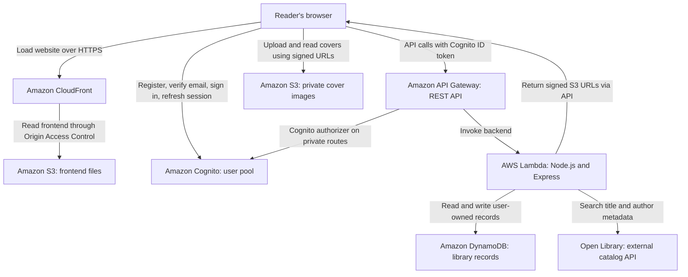

# Where each AWS service is used in Margin

**Current implementation, checked on 21 November 2026.** This document describes the code in this repository and the deployed `margin` stack. The stack status was `UPDATE_COMPLETE`, and CloudFront reported `Deployed` during this review. This was a read-only documentation review; it did not redeploy the app or repeat the earlier integration tests.

Margin is a personal book-reading library. Readers save books, track reading status, record notes and highlights, rate books, view statistics and optionally publish a shortlist. The frontend uses native HTML, CSS and JavaScript. The backend uses Node.js and Express, deployed as **one Lambda function** containing several business-service modules.

- Website: **https://d21kijacbodwl6.cloudfront.net**
- REST API base URL: **https://qxmrpfw256.execute-api.us-east-1.amazonaws.com/prod**
- Regional resources: **`us-east-1`**. CloudFront provides global content delivery.
- Infrastructure definition: [template.yaml](../template.yaml).

## 1. Architecture at a glance

The browser calls Cognito and API Gateway directly. CloudFront currently delivers **frontend files only**: API requests and private cover downloads do not pass through this distribution. Lambda authorizes cover access and signs URLs; the browser transfers image bytes directly to S3.

| Requested AWS service | Current responsibility | Where readers encounter it |
| --- | --- | --- |
| Amazon S3 | Stores frontend assets and private book-cover images | Opening the app and uploading/displaying covers |
| Amazon CloudFront | Delivers frontend assets over HTTPS | Every visit to the website |
| Amazon Cognito | Manages accounts, passwords and authentication tokens | Registration, email verification, login and password reset |
| Amazon API Gateway | Exposes the REST API and checks authentication on protected routes | Saving books, opening notes, viewing statistics and sharing lists |
| AWS Lambda | Executes Express routes, authorization and business rules | All backend operations |
| Amazon DynamoDB | Persists user-owned book, journal and sharing records | Data remaining available after refresh, logout or another session |

## 2. Amazon S3 — frontend assets and book covers

### Frontend storage

**Bucket:** `margin-webbucket-tmqp7zmvcmrb`  
**Template resources:** `WebBucket`, `WebBucketPolicy`

The bucket contains the production frontend: `index.html`, `styles.css`, `app.js` and `config.js`. The bucket has public access blocked. CloudFront reads these objects through Origin Access Control and a bucket policy scoped to the deployed distribution. This uses a private S3 origin, not a public S3 website endpoint.

[scripts/build.mjs](../scripts/build.mjs) copies the native frontend to `dist/` and generates production configuration containing the API URL, AWS region and Cognito client ID. [scripts/deploy-frontend.sh](../scripts/deploy-frontend.sh) uploads that directory to S3 and requests a CloudFront cache invalidation.

### Cover-image storage

**Bucket:** `margin-coversbucket-cu99fr8zjyf9`  
**Template resource:** `CoversBucket`

When a reader selects **Upload cover**, the frontend requests an upload URL from `POST /api/books/:id/cover`. Lambda checks book ownership, declared file type and size, then returns a signed URL valid for five minutes. Allowed formats are JPEG, PNG and WebP, with a maximum declared size of 5 MiB. The signature binds the content type and byte length.

The browser uploads directly to S3, then saves the returned `coverKey` on the book through the normal book-update endpoint. S3 stores the image bytes; DynamoDB stores only the key. To display an image, the frontend requests `GET /api/books/:id/cover`, which returns a five-minute signed read URL after an ownership check.

Object keys follow `covers/<Cognito sub>/<book ID>/<random UUID>`. Public shortlists do not expose covers. Cover-bucket CORS permits PUT from the current CloudFront origin. The server validates declared metadata; it does not decode or scan uploaded image content.

**Code:** [covers.js](../backend/src/services/covers.js), cover routes in [app.js](../backend/src/app.js), and the cover-file handler in [frontend/app.js](../frontend/app.js).

### Deployment artifacts

A third private S3 bucket belongs to the `margin-artifacts` stack and stores packaged Lambda deployment code. It is used during deployment, not by readers. See [infrastructure/artifacts.yaml](../infrastructure/artifacts.yaml) and [deploy-backend.sh](../scripts/deploy-backend.sh).

## 3. Amazon CloudFront — secure frontend delivery

**Distribution:** `E1WGBG2H9IURUJ`  
**Domain:** `d21kijacbodwl6.cloudfront.net`  
**Template resources:** `Distribution`, `OriginAccess`, `SecurityHeaders`

CloudFront receives the browser's website request, serves cached frontend assets when available and otherwise reads them from the frontend S3 bucket. `index.html` is the default root object. The distribution redirects HTTP requests to HTTPS, enables compression and adds security headers, including Content Security Policy, HSTS, frame protection and MIME-type protection.

The distribution currently uses the default CloudFront certificate. **No custom domain aliases are attached.** Cloudflare DNS and a custom ACM certificate have been discussed but are not configured in the current deployment. CloudFront is not hosting or executing Express.

**Code/configuration:** CloudFront resources in [template.yaml](../template.yaml); cache invalidation in [deploy-frontend.sh](../scripts/deploy-frontend.sh).

## 4. Amazon Cognito — accounts and authentication

**User pool:** `us-east-1_xbV2ShYbQ`  
**App client:** `3acm778j965uihfnpk524vn6ll`  
**Template resources:** `UserPool`, `UserPoolClient`

The frontend communicates directly with the regional Cognito API. It implements these account actions:

| User action | Cognito operation / flow |
| --- | --- |
| Create account | `SignUp` |
| Confirm email | `ConfirmSignUp` |
| Resend verification code | `ResendConfirmationCode` |
| Sign in | `InitiateAuth` with `USER_PASSWORD_AUTH` |
| Refresh session | `InitiateAuth` with `REFRESH_TOKEN_AUTH` |
| Request password reset | `ForgotPassword` |
| Complete password reset | `ConfirmForgotPassword` |

Passwords are handled by Cognito, not stored in DynamoDB or sent to the Express API. The public app client has no client secret. The configured password policy requires at least 12 characters and uppercase, lowercase, numeric and symbol characters.

After login, the frontend keeps the ID token, refresh token and session metadata in `sessionStorage`. Private API requests send `Authorization: Bearer <ID token>`. API Gateway applies its Cognito authorizer, and Express independently verifies the JWT signature, issuer, expiry, token type and app client using `aws-jwt-verify`.

The verified token's `sub` identifies the reader and determines the DynamoDB partition. The application does not trust a user-supplied owner ID. Signing out clears this tab's stored session; it does not perform global token revocation. There is no administrator role or Cognito Identity Pool in this implementation.

**Code:** `cognito()`, `saveSession()`, `api()` and the authentication form in [frontend/app.js](../frontend/app.js); `CognitoJwtVerifier` and authentication middleware in [backend/src/app.js](../backend/src/app.js).

## 5. Amazon API Gateway — REST endpoints

**REST API:** `qxmrpfw256`  
**Stage:** `prod`  
**Template resource:** `Api`, with event mappings under `ApiFunction`

API Gateway is the public entry point for backend operations. The `/api/{proxy+}` integration forwards requests to Lambda, where Express matches individual routes. Private routes use a Cognito authorizer. CORS allows the deployed CloudFront origin, and unauthenticated OPTIONS requests support browser preflight. The template configures a throttle rate of 20 requests per second and a burst limit of 40.

| Endpoint group | Purpose | Authentication |
| --- | --- | --- |
| `GET/POST /api/books` | List or create owned books | Required |
| `PUT/DELETE /api/books/:id` | Update or delete an owned book | Required |
| `GET/POST /api/books/:id/entries` | Read or add notes/highlights | Required |
| `DELETE /api/books/:id/entries/:entryId` | Delete an entry | Required |
| `GET/POST /api/books/:id/cover` | Obtain signed cover read/upload URLs | Required |
| `GET /api/stats` | Reading totals, monthly completions, genre means and next-up | Required |
| `POST/DELETE /api/share` | Enable or revoke shortlist sharing | Required |
| `GET /api/catalog` | Search Open Library metadata | Required |
| `GET /api/public/:token` | View an enabled public shortlist | Public |
| `GET /api/health` | Basic application health response | Public |

API Gateway does not decide who owns a book or calculate statistics. Those checks run in Lambda. Missing/invalid authentication returns 401. Unknown and foreign book/entry IDs return 404 to conceal record existence; an invalid cross-owner cover assignment returns 403.

**Code/configuration:** [template.yaml](../template.yaml), Express route declarations in [app.js](../backend/src/app.js), and the frontend `api()` helper. Detailed request bodies are in [API.md](API.md).

## 6. AWS Lambda — backend execution and business rules

**Function:** `margin-ApiFunction-GuvnteWkx0fC`  
**Runtime:** Node.js 22, arm64, 256 MB memory, 30-second timeout  
**Handler:** `src/lambda.handler`  
**Template resource:** `ApiFunction`

[lambda.js](../backend/src/lambda.js) wraps the Express application using `serverless-http` 4.x. API Gateway invokes this handler for API requests. The same Express application runs locally through [server.js](../backend/src/server.js).

The three principal business-service modules share one authenticated application and one Lambda deployment:

| Module | Actual backend rules and operations |
| --- | --- |
| [Library](../backend/src/services/library.js) | Requires ownership for existing books; validates status, rating and completion date; checks cover-key ownership; clears next-up when a book becomes reading/finished; removes dependent journal entries when deleting a book |
| [Journal](../backend/src/services/journal.js) | Consults Library ownership and status; allows planning notes for to-read books but rejects highlights until the book is started; validates text/page fields and checks entry membership before deletion |
| [Insights and sharing](../backend/src/services/insights.js) | Reads Library records to compute statistics and shortlist eligibility; enables/revokes share links; verifies both sharing records and exposes only title, author, genre and status publicly |

Supporting modules include [domain.js](../backend/src/domain.js) for validation and calculations, [covers.js](../backend/src/services/covers.js) for S3 signing, and [catalog.js](../backend/src/services/catalog.js) for Open Library integration.

Monthly counts use completion dates on finished books. Genre averages use rated books only. Next-up contains pinned to-read or paused books. **The current next-up feature is a rule-based shortlist, not an AI recommendation engine.**

Lambda receives `TABLE_NAME`, `USER_POOL_ID`, `CLIENT_ID`, `COVERS_BUCKET`, `FRONTEND_ORIGIN` and `LOCAL_DEV=false` as environment configuration. Its IAM execution role grants access to the application table and the cover bucket's `covers/*` prefix; backend credentials are not embedded in source code.

## 7. Amazon DynamoDB — persistent application data

**Table:** `margin-LibraryTable-5X6X6HD5UNGD`  
**Template resource:** `LibraryTable`

DynamoDB stores books, statuses, ratings, completion dates, shortlist pins, cover keys, notes, highlights and sharing configuration. It does not store passwords or image bytes. Statistics are computed from book records on request rather than kept in a separate statistics table.

The table has string partition/sort keys (`pk`, `sk`), on-demand billing, encryption and point-in-time recovery. A Retain policy preserves it when the application stack is deleted.

| Record | Partition key (`pk`) | Sort key (`sk`) |
| --- | --- | --- |
| Book | `USER#<Cognito sub>` | `BOOK#<book UUID>` |
| Note/highlight | `USER##BOOK#<book UUID>` | `<entry UUID>` |
| User sharing configuration | `USER#` | `SETTINGS` |
| Public-share lookup | `SHARE` | `<share token>` |

[store.js](../backend/src/store.js) uses `DynamoDBDocumentClient` with `QueryCommand`, `GetCommand`, `PutCommand` and `DeleteCommand`. Queries paginate through DynamoDB result pages. The application's access patterns do not require table scans or secondary indexes.

Owner partitions are derived from verified identity. A public request uses a share token to locate the owner's shortlist, then returns an explicit projection of permitted fields. Updates currently use last-write-wins behavior, and deleting a book plus its journal entries is not transactional. More details are in [DATABASE.md](DATABASE.md).

## 8. How the services work together

### Saving and finishing a book

1. CloudFront delivers the frontend from S3.
2. Cognito authenticates the reader and supplies an ID token.
3. The browser sends book details and the token to API Gateway.
4. API Gateway authenticates the request and invokes Lambda.
5. Express verifies identity; Library validates the book and derives the owner partition.
6. The store writes the book to DynamoDB, and the API returns the saved record.
7. When the reader finishes the book, Lambda requires a completion date and clears its next-up pin.
8. Reading Insights calls `/api/stats`; Lambda calculates results from current DynamoDB book records.

### Adding a highlight

The authenticated entries request passes through API Gateway to Lambda. Journal asks Library for the owned book, rejects a to-read book with 409, and otherwise saves the highlight in that book's DynamoDB journal partition. The browser cannot bypass this rule by changing its form controls.

### Uploading a cover

The authenticated API call requests permission and a signed upload URL. Lambda authorizes the book; the browser then uploads directly to S3. A separate book update stores the S3 key in DynamoDB. An authorized read request obtains a temporary download URL. The image is never made publicly readable through a bucket policy.

### Viewing a public shortlist

The visitor loads the frontend through CloudFront and opens a URL containing `?list=<token>`. The frontend calls the public API endpoint. Lambda checks the DynamoDB share lookup and corresponding user setting, selects eligible books, and returns only the four permitted fields. The visitor does not need a Cognito account. Revoking the link removes its sharing records.

## 9. Supporting services and external integration

These support the six requested AWS services; they are not separate student business-service modules.

| Component | Current use | Implementation |
| --- | --- | --- |
| AWS CloudFormation / SAM transform | Creates and updates infrastructure from templates | [template.yaml](../template.yaml), [artifacts.yaml](../infrastructure/artifacts.yaml), [deploy-backend.sh](../scripts/deploy-backend.sh) |
| AWS IAM | Lambda execution role, scoped DynamoDB/S3 permissions, and AWS deployment permissions | `ApiFunction.Policies` in [template.yaml](../template.yaml) |
| Amazon CloudWatch Logs | Lambda execution logs and sanitized application failure diagnostics; log-group retention is 14 days | `ApiLogGroup` in [template.yaml](../template.yaml); [app.js](../backend/src/app.js), [catalog.js](../backend/src/services/catalog.js) |
| Open Library (external, not AWS) | Searches real title/author metadata; a selected result populates the add-book form for review and saving | [catalog.js](../backend/src/services/catalog.js), `/api/catalog`, catalog controls in [frontend/app.js](../frontend/app.js) |

Open Library receives explicit search terms, not private notes or Cognito tokens. Search has query limits, a six-second timeout and a small five-minute per-process cache. If it fails, the API returns an actionable error and manual book entry remains available.

**Not currently configured for this app:** a Cloudflare custom domain, a custom ACM certificate, Route 53, EC2 servers, relational databases, separate Lambda functions per module, or an admin-role workflow. The API retains its `execute-api` domain.

## 10. Local mode and verification evidence

Local development uses Express on loopback, one fixed development reader and a JSON file through the same store interface. It does not authenticate through Cognito or persist to DynamoDB unless configured for the AWS path. Cloud cover uploads require the deployed S3 configuration. Local mode is explicitly blocked inside Lambda.

The previous deployment verification exercised all six requested AWS services using temporary Cognito accounts and records: login, API authorization/CORS, DynamoDB persistence, notes/highlight rules, sharing, S3 upload/download, statistics and Open Library search. Test records and accounts were removed. Nine local tests also passed, including Lambda JSON parsing and S3-signature regression tests.

| Evidence | Location |
| --- | --- |
| Live deployment identifiers and verification boundaries | [DEPLOYMENT.md](DEPLOYMENT.md) |
| Repeatable AWS integration test and cleanup | [scripts/smoke-aws.py](../scripts/smoke-aws.py) |
| Authentication, ownership and workflow tests | [backend/test](../backend/test) |
| Setup and deployment commands | [SETUP.md](SETUP.md) |
| Assignment requirements mapped to implementation | [REQUIREMENTS.md](REQUIREMENTS.md) |
| Application-specific risks and controls | [THREAT-MODEL.md](THREAT-MODEL.md) |

Browser rendering and account-verification email delivery were not established by the automated deployment smoke test. This document does not claim that those manual checks have been completed.
